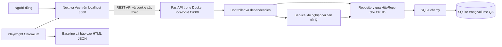

# Kiến trúc và luồng dữ liệu R02 K10

## Phiên bản khảo sát
Mealie 3.28.0, commit `879b133b5f98dd91419948f363d2d6d58793c3a0`. Frontend Nuxt 4/Vue 3/TypeScript/Vuetify; backend FastAPI/Pydantic; SQLAlchemy và SQLite trong môi trường QA. PostgreSQL là tùy chọn của upstream, chưa nằm trong phạm vi kiểm chứng này.

## Component và container

Các CRUD đơn giản có thể đi từ controller qua HttpRepo tới repository; không phải mọi request đều bắt buộc đi qua service. Repository áp dụng phạm vi group/household theo loại dữ liệu. Dữ liệu công thức có thể được chia sẻ ở phạm vi group, còn meal plan và shopping list gắn household.

## Actor và use case
Người dùng: đăng nhập, tìm/xem công thức, phân loại công thức, lập thực đơn và xem danh sách mua sắm. Người tổ chức dữ liệu: quản lý food/category khi có quyền canOrganize. QA: dựng môi trường, tạo dữ liệu riêng, duyệt ảnh baseline và phân tích diff. Quản trị viên: quản lý tài khoản và cấu hình hệ thống.

## Luồng một tìm công thức
1. Người dùng mở `/g/{groupSlug}/recipes/finder` và nhập bộ lọc.
2. Page/composable gọi API client của frontend.
3. Request đọc công thức đi tới route recipe hoặc explore tùy ngữ cảnh hiển thị và quyền truy cập.
4. Controller nhận pagination/filter, repository truy vấn công thức trong phạm vi hợp lệ và trả schema Pydantic.
5. Vue render card, search/filter và trạng thái rỗng. VR01 kiểm tra trạng thái No recipes found trước khi chọn nguyên liệu.
Nguồn: `frontend/app/pages/g/[groupSlug]/recipes/finder/index.vue`, `mealie/routes/recipe/recipe_crud_routes.py`, `mealie/routes/explore/controller_public_recipes.py`, `mealie/repos/repository_recipes.py`.

## Luồng hai lập thực đơn
1. Người dùng chọn ngày và công thức ở `/household/mealplan/planner/view`.
2. Frontend gửi POST `/api/households/mealplans` với date, entryType và recipeId.
3. GroupMealplanController kiểm tra schema và gắn group/user từ người đăng nhập.
4. HttpRepo/repository lưu entry; controller phát sự kiện mealplan_entry_created.
5. Frontend tải thực đơn theo khoảng ngày và cập nhật lịch. VR04 kiểm tra có QA Recipe trong tuần cố định.
Nguồn: `frontend/app/composables/use-group-mealplan.ts`, `mealie/routes/households/controller_mealplan.py`, `mealie/repos/repository_meals.py`, `mealie/schema/meal_plan/new_meal.py`.

## Luồng ba danh sách mua sắm
1. Người dùng tạo danh sách, thêm mục hoặc thêm nguyên liệu từ công thức.
2. Frontend gọi `/api/households/shopping/lists` hoặc endpoint item/recipe tương ứng.
3. Controller dùng HttpRepo cho CRUD danh sách; ShoppingListService xử lý nghiệp vụ liên quan công thức và item.
4. Repository lưu danh sách/mục theo household và phát sự kiện cập nhật.
5. Vue hiển thị danh sách hoặc chi tiết. VR05 bảo vệ trang danh sách, chưa bao phủ chi tiết thêm/xóa item bằng ảnh.
Nguồn: `mealie/routes/households/controller_shopping_lists.py`, `mealie/services/household_services/shopping_lists.py`, `frontend/app/pages/shopping-lists/index.vue`.

## Ranh giới kiểm thử
K10 kiểm tra kết quả render sau khi dữ liệu và layout ổn định, không chứng minh đầy đủ tính đúng của API, an toàn dữ liệu hay hiệu năng. Các smoke test nghiệp vụ bổ sung bằng chứng chức năng cho ba luồng nhưng không thay thế toàn bộ bộ test upstream.
